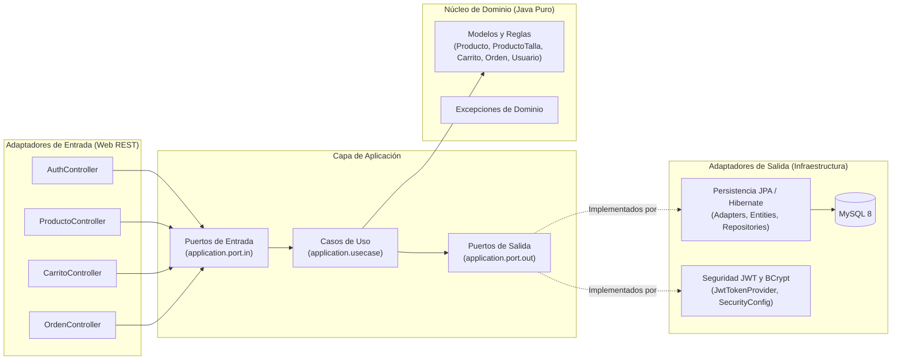

# Camisas Tienda — Backend de Tienda de Camisetas de Fútbol

API RESTful de muestra para una tienda de camisetas deportivas de fútbol con gestión de catálogo, stock por talla, carrito de compras, checkout transaccional (con bloqueo optimista) y autenticación basada en **JWT**, construida bajo **Arquitectura Hexagonal (Puertos y Adaptadores)**.

---

## Stack Tecnológico

| Componente | Tecnología |
|---|---|
| **Lenguaje** | Java 21 (LTS) |
| **Framework** | Spring Boot 3.5.6 |
| **Gestor de dependencias** | Apache Maven 3.9+ |
| **Base de datos** | MySQL 8.x |
| **Persistencia (ORM)** | Spring Data JPA / Hibernate 6 |
| **Migraciones de BD** | Flyway (`V1`, `V2`, `V3`) |
| **Seguridad** | Spring Security 6 + JWT (`jjwt 0.12.6`) + BCrypt |
| **Documentación API** | SpringDoc OpenAPI 3 (Swagger UI) |
| **Monitoreo** | Spring Boot Actuator (`/actuator/health`) |
| **Pruebas** | JUnit 5, Mockito, ArchUnit, Spring Boot Test, Testcontainers (MySQL) |
| **Contenedores** | Docker (Multi-stage build) + Docker Compose |

---

## Arquitectura Hexagonal (Puertos y Adaptadores)

El proyecto separa estrictamente la lógica de negocio (dominio puro sin dependencias de frameworks) de los casos de uso y de los detalles técnicos (web, base de datos, seguridad). Esta separación se valida automáticamente mediante pruebas de **ArchUnit**.



### Estructura de Directorios

```text
camisas_tienda/
├── database/                         # Scripts SQL independientes para ejecución manual
│   ├── schema.sql                    # Creación de base de datos y las 7 tablas
│   └── data.sql                      # Datos semilla iniciales
├── planeacion/                       # Plan de tareas del proyecto (00 a 10)
├── scripts/                          # Scripts de pruebas de humo (smoke tests)
│   ├── smoke-test.ps1                # Script para Windows PowerShell
│   └── smoke-test.sh                 # Script para Linux / macOS / Git Bash
├── src/
│   ├── main/
│   │   ├── java/com/camisastienda/
│   │   │   ├── domain/               # Modelos y excepciones de negocio (Java puro)
│   │   │   ├── application/          # Puertos (in/out) y casos de uso
│   │   │   └── infrastructure/       # Controladores REST, JPA/Hibernate, JWT y seguridad
│   │   └── resources/
│   │       ├── application.yml       # Configuración por perfiles (dev, docker)
│   │       └── db/migration/         # Migraciones automáticas de Flyway (V1, V2, V3)
│   └── test/                         # Pruebas unitarias (*Test) y de integración (*IT)
├── Dockerfile                        # Construcción multi-stage (Maven JDK 21 -> JRE 21 Alpine)
├── docker-compose.yml                # Orquestación de MySQL 8 + API Spring Boot
└── pom.xml                           # Configuración de Maven
```

---

## Manual de Despliegue

### 1. Requisitos Previos

- **Para despliegue con Docker (Recomendado):**
  - [Docker Desktop](https://www.docker.com/products/docker-desktop/) (con `docker compose`).
- **Para despliegue local sin Docker:**
  - **Java JDK 21** instalado y configurado en `JAVA_HOME`.
  - **Apache Maven 3.9+**.
  - **MySQL Server 8.x** corriendo localmente en el puerto `3306`.

---

### 2. Despliegue con Docker (Paso a Paso)

1. **Clonar el repositorio y entrar a la carpeta del proyecto:**
   ```bash
   cd camisas_tienda
   ```

2. **(Opcional) Crear el archivo `.env` a partir de la plantilla:**
   ```bash
   # En Linux / macOS / Git Bash
   cp .env.example .env

   # En Windows PowerShell
   Copy-Item .env.example .env
   ```

3. **Construir y levantar los contenedores en segundo plano:**
   ```bash
   docker compose up -d --build
   ```
   - El contenedor `camisas-tienda-mysql` levantará MySQL 8 en el puerto **`3307`** de tu máquina (`3307:3306`) para no chocar con un MySQL local.
   - Una vez que el `healthcheck` de MySQL esté listo (`healthy`), arrancará `camisas-tienda-api` en el puerto **`8080`**.
   - **Flyway** creará automáticamente las tablas y cargará las camisetas y usuarios de prueba.

4. **Verificar el estado de los contenedores:**
   ```bash
   docker compose ps
   docker compose logs -f api
   ```

5. **Detener los servicios cuando termines:**
   ```bash
   docker compose down
   ```

---

### 3. Despliegue Local sin Docker (Paso a Paso)

1. **Crear la base de datos en tu MySQL local (`localhost:3306`):**
   - Puedes dejar que **Flyway** cree las tablas automáticamente creando solo la base de datos vacía:
     ```sql
     CREATE DATABASE IF NOT EXISTS camisas_tienda CHARACTER SET utf8mb4 COLLATE utf8mb4_unicode_ci;
     ```
   - O bien ejecutar manualmente en MySQL Workbench los scripts [`database/schema.sql`](database/schema.sql) y [`database/data.sql`](database/data.sql).

2. **Configurar las variables de entorno (si tu usuario/contraseña difiere del valor por defecto):**
   En `application.yml` la conexión por defecto usa `root` / `23242526`. Si tienes otra contraseña (por ejemplo `admin`), define las variables antes de iniciar:
   ```powershell
   # Windows PowerShell
   $env:DB_USERNAME="root"
   $env:DB_PASSWORD="tu_password"
   ```
   ```bash
   # Linux / macOS / Git Bash
   export DB_USERNAME=root
   export DB_PASSWORD=tu_password
   ```

3. **Compilar y ejecutar la aplicación con Maven:**
   ```bash
   mvn spring-boot:run
   ```
   La API quedará disponible en `http://localhost:8080`.

---

### 4. Variables de Entorno

| Variable | Descripción | Valor por defecto (`application.yml` / `docker-compose.yml`) |
|---|---|---|
| `SPRING_PROFILES_ACTIVE` | Perfil activo de Spring (`dev`, `docker`, `test`) | `dev` (`docker` en Compose) |
| `SERVER_PORT` | Puerto HTTP donde escucha la API | `8080` |
| `DB_URL` | URL JDBC de conexión a MySQL | `jdbc:mysql://localhost:3306/camisas_tienda...` |
| `DB_USERNAME` | Usuario de la base de datos MySQL | `root` |
| `DB_PASSWORD` | Contraseña de la base de datos MySQL | `23242526` |
| `JWT_SECRET` | Clave secreta para firmar tokens HS256 (mín. 32 bytes) | `cambia-este-secreto-de-desarrollo-por-uno-de-al-menos-32-bytes` |
| `JWT_EXPIRATION` | Tiempo de expiración del token JWT en milisegundos | `3600000` (1 hora) |

---

### 5. Usuarios Semilla por Defecto

Al iniciar la aplicación, Flyway carga automáticamente dos usuarios de prueba:

| Rol | Email | Contraseña | Permisos |
|---|---|---|---|
| **ADMIN** | `admin@camisastienda.com` | `admin123` | Crear, editar, eliminar camisetas y ajustar stock por talla |
| **CLIENTE** | `cliente@camisastienda.com` | `cliente123` | Ver catálogo, gestionar su carrito de compras y realizar checkout |

---

### 6. Verificación del Despliegue

1. **Endpoint de salud (Healthcheck):**
   ```bash
   curl http://localhost:8080/actuator/health
   ```
   Respuesta esperada:
   ```json
   {"status":"UP"}
   ```

2. **Documentación interactiva Swagger UI:**
   Abre en el navegador:
   - [http://localhost:8080/swagger-ui.html](http://localhost:8080/swagger-ui.html)
   - Especificación OpenAPI JSON: [http://localhost:8080/v3/api-docs](http://localhost:8080/v3/api-docs)

3. **Script automático de prueba de humo (Smoke Test):**
   Con la aplicación arriba, ejecuta:
   ```powershell
   # En Windows PowerShell
   .\scripts\smoke-test.ps1
   ```
   ```bash
   # En Linux / macOS / Git Bash
   bash scripts/smoke-test.sh
   ```

---

### 7. Solución de Problemas Comunes

- **Error `Port 8080 was already in use`:**
  Cambia el puerto definiendo `SERVER_PORT=8081` antes de arrancar o en tu archivo `.env`.
- **Conflicto con el puerto `3306` de MySQL local al usar Docker:**
  El archivo `docker-compose.yml` ya expone el contenedor de MySQL en el puerto **`3307`** (`3307:3306`) para evitar conflictos con tu MySQL local.
- **Error `Access denied for user 'root'@'localhost'` en ejecución local:**
  Verifica que la variable `DB_PASSWORD` coincida con la contraseña de tu servidor MySQL local.
- **Fallo en pruebas de integración (`*IT`) por Docker:**
  Las pruebas de integración usan **Testcontainers**, por lo que **Docker Desktop debe estar encendido** al ejecutar `mvn verify`.

---

## Ejecución de Pruebas

El proyecto separa las pruebas unitarias rápidas de las pruebas de integración con base de datos real:

1. **Ejecutar solo pruebas unitarias y de arquitectura (No requiere Docker):**
   ```bash
   mvn test
   ```
   Ejecuta todas las pruebas `*Test.java` (dominio, casos de uso con Mockito, mappers, adaptadores, manejador de errores y reglas de arquitectura hexagonal con ArchUnit).

2. **Ejecutar todas las pruebas incluyendo Integración con Testcontainers (Requiere Docker activo):**
   ```bash
   mvn verify
   ```
   Levanta automáticamente un contenedor MySQL 8.4 real con Testcontainers, ejecuta las migraciones de Flyway y corre todas las pruebas `*IT.java` (`CamisasTiendaApplicationIT`, `PersistenciaJpaIT`, `CarritoControllerIT`, `OrdenControllerIT`).

---

## Resumen de Endpoints y Ejemplos `curl`

### Tabla General de Endpoints

| Método | Ruta | Acceso | Descripción |
|---|---|---|---|
| `GET` | `/actuator/health` | Público | Estado de salud del servidor |
| `POST` | `/api/auth/registro` | Público | Registra un nuevo usuario con rol `CLIENTE` |
| `POST` | `/api/auth/login` | Público | Inicia sesión y devuelve el token JWT |
| `GET` | `/api/auth/me` | Autenticado | Devuelve el email del usuario autenticado |
| `GET` | `/api/productos` | Público | Lista camisetas activas (filtros: `equipo`, `liga`, `nombre`, `talla`, `page`, `size`) |
| `GET` | `/api/productos/{id}` | Público | Obtiene el detalle de una camiseta con sus tallas y stock |
| `POST` | `/api/productos` | `ADMIN` | Crea una nueva camiseta en el catálogo |
| `PUT` | `/api/productos/{id}` | `ADMIN` | Actualiza los datos de una camiseta |
| `DELETE` | `/api/productos/{id}` | `ADMIN` | Borrado lógico de la camiseta (`activo = false`) |
| `PATCH` | `/api/productos/{id}/tallas/{talla}/stock` | `ADMIN` | Crea o ajusta el stock disponible de una talla (`XS`..`XXL`) |
| `GET` | `/api/carrito` | `CLIENTE` | Obtiene el carrito actual con subtotales y total |
| `POST` | `/api/carrito/items` | `CLIENTE` | Agrega un producto y talla al carrito |
| `PUT` | `/api/carrito/items/{itemId}` | `CLIENTE` | Modifica la cantidad de un ítem del carrito |
| `DELETE` | `/api/carrito/items/{itemId}` | `CLIENTE` | Elimina un ítem específico del carrito |
| `DELETE` | `/api/carrito` | `CLIENTE` | Vacía por completo el carrito |
| `POST` | `/api/ordenes/checkout` | `CLIENTE` | Genera la orden, descuenta el stock y vacía el carrito |
| `GET` | `/api/ordenes` | `CLIENTE` | Lista el historial de órdenes del cliente |
| `GET` | `/api/ordenes/{id}` | `CLIENTE` | Consulta el detalle de una orden específica |

---

### Ejemplos de Uso con `curl`

#### 1. Iniciar sesión como Cliente y obtener Token JWT
```bash
curl -X POST http://localhost:8080/api/auth/login \
  -H "Content-Type: application/json" \
  -d '{"email": "cliente@camisastienda.com", "password": "cliente123"}'
```

#### 2. Listar camisetas filtrando por liga
```bash
curl "http://localhost:8080/api/productos?liga=LaLiga"
```

#### 3. Agregar una camiseta al carrito (requiere token de `CLIENTE`)
```bash
curl -X POST http://localhost:8080/api/carrito/items \
  -H "Authorization: Bearer <TU_TOKEN_CLIENTE>" \
  -H "Content-Type: application/json" \
  -d '{"productoId": 1, "talla": "M", "cantidad": 2}'
```

#### 4. Realizar Checkout (crea la orden y descuenta el stock)
```bash
curl -X POST http://localhost:8080/api/ordenes/checkout \
  -H "Authorization: Bearer <TU_TOKEN_CLIENTE>"
```

#### 5. Crear producto y ajustar stock (requiere token de `ADMIN`)
```bash
# Crear camiseta
curl -X POST http://localhost:8080/api/productos \
  -H "Authorization: Bearer <TU_TOKEN_ADMIN>" \
  -H "Content-Type: application/json" \
  -d '{
    "nombre": "Camiseta Liverpool Local 24/25",
    "descripcion": "Versión oficial local",
    "equipo": "Liverpool",
    "liga": "Premier League",
    "temporada": "2024/2025",
    "precio": 92.50,
    "imagenUrl": "https://images.unsplash.com/photo-1522778119026-d647f0596c20"
  }'

# Asignar stock a la talla M
curl -X PATCH http://localhost:8080/api/productos/6/tallas/M/stock \
  -H "Authorization: Bearer <TU_TOKEN_ADMIN>" \
  -H "Content-Type: application/json" \
  -d '{"stock": 15}'
```
